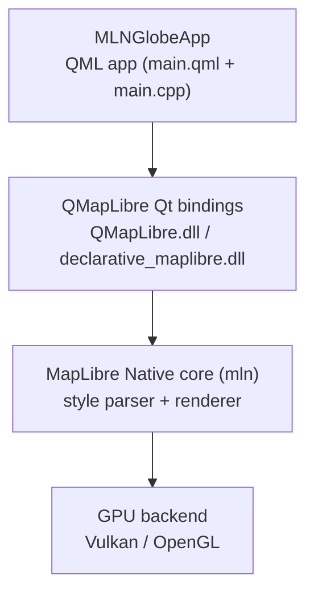

## Summary

MLNGlobeApp is a single Qt Quick application. It renders maps through an installed **`QMapLibre`** package, which is the [MapLibre Native Qt](../concepts/maplibre-native-qt.md) bindings; those bindings wrap the vendored [MapLibre Native](../concepts/maplibre-native.md) core, which draws through a GPU backend. Only the top layer — the app — is written here; the other three are built from a fork of MapLibre Native Qt.

## Diagram

## The layers

| Layer | What | Source |
|-------|------|--------|
| MLNGlobeApp app | The QML UI and the C++ entry point | `C:\hda\dev\Projects\MapLibreEarth` |
| [`QMapLibre`](../modules/qmaplibre-core.md) bindings | `QMapLibre::Map`, `Settings`, `MapRenderer`; the `MapLibre` QML item and its texture nodes | `maplibre-native-qt` `src/core`, `src/quick` |
| [MapLibre Native](../concepts/maplibre-native.md) core | Style parsing, tile loading, symbol/layer rendering (`mbgl-core` target) | `vendor/maplibre-native` (namespace `mln`) |
| GPU backend | Vulkan (`MLN_WITH_VULKAN=ON`) or OpenGL | The core's renderer |

## How the app uses it

The app's QML imports the `MapLibre` module (`import MapLibre 4.0`) and instantiates the `MapLibre` item — the C++ [`MapQuickItem`](./). That item owns a `QMapLibre::Map`, hands the style a URL, and renders into a Qt Quick texture node. Camera, gestures and style switching are driven from QML through `QMapLibre::Map` invokables (`flyTo`, `scale`, `pan`, `setStyleUrl`).

## The vendored core and the patches

MapLibre Native is a **git submodule** pinned to a tag, not a fork dependency of upstream. To render the [Open Waters](../flows/open-waters-rendering.md) style, the project applies a small set of [downstream patches](../references/fork-patches.md) to that submodule at configure time. See [D2](../decisions/d2-upgrade-13-6-1.md) and [D3](../decisions/d3-downstream-patches.md).

## Related

- [Technology](./technology.md) · [Environment](./environment.md) · [Concepts](../concepts/index.md) · [Modules](../modules/index.md)
